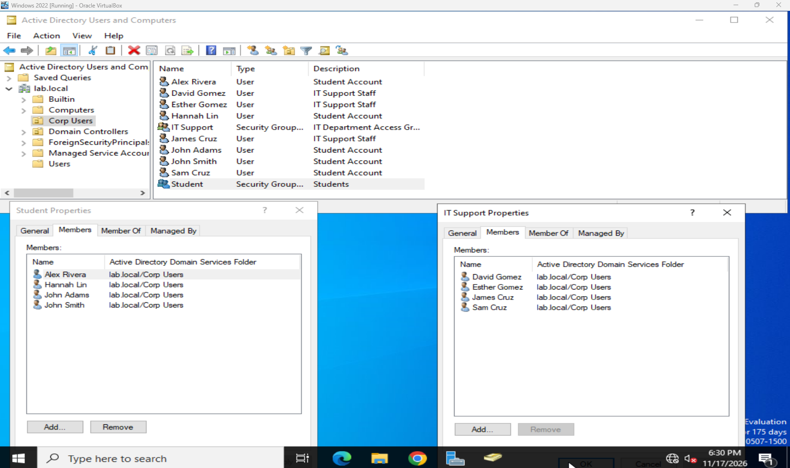

# Active Directory Enterprise Lab

A production-aligned Active Directory (AD) proof-of-concept environment built to demonstrate core IT Operations, user lifecycle management, and role-based access control (RBAC).

## 🏗️ Architecture & Environment
- **Domain Controller (DC):** Windows Server 2022 (`lab.local`) running Active Directory Domain Services (AD DS), DNS, and security policy enforcement.
- **Client Machine:** Windows 11 Enterprise virtual machine joined to the domain.
- **Hypervisor:** Oracle VirtualBox with isolated internal virtual networking.

---

## 📂 Organizational Structure & User Provisioning
The directory is structured using a dedicated Organizational Unit (`Corp Users`) to segregate roles and apply granular security policies:

- **Security Groups:**
  - `IT Support`: Administrative and help desk tier with management rights.
  - `Student`: Standard user access tier.
- **User Accounts:**
  - **IT Support Staff:** David Gomez, Esther Gomez, James Cruz, Sam Cruz
  - **Student Accounts:** Alex Rivera, Hannah Lin, John Adams, John Smith, Sam Cruz

---

## 🔒 Security Policies & Lifecycle Management
This environment showcases standard enterprise administrative workflows:
1. **Initial Provisioning & First-Time Logon:** User accounts are initialized with temporary credentials, prompting secure password modification upon initial domain authentication.
2. **Account Disablement & Access Control:** Demonstrates immediate session termination and authentication denial when an administrator disables an account in ADUC.
3. **Password Complexity:** Enforces Windows Server default domain complexity rules (uppercase, lowercase, numbers, and symbols) while preventing username conflict blocks.

---

## 🚀 Key Takeaways & Skills Demonstrated
- **Identity and Access Management (IAM):** Provisioning users, managing OUs, and nesting security groups.
- **Access Control Enforcement:** Verifying domain controller policy enforcement across client workstations.
- **Documentation & Runbooks:** Maintaining clean technical documentation for IT operations and engineering handovers.
